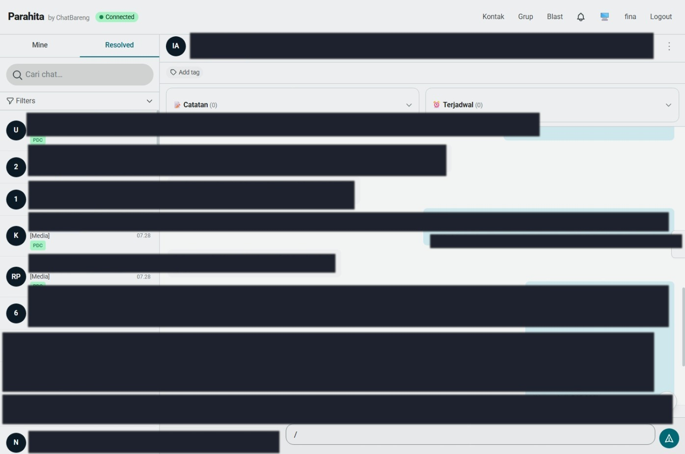
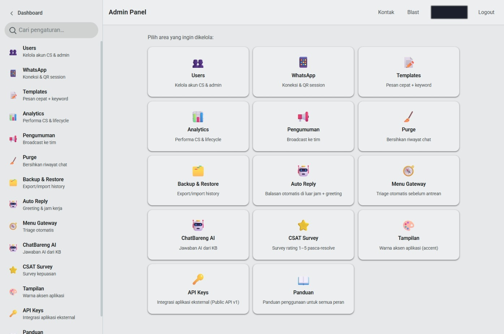
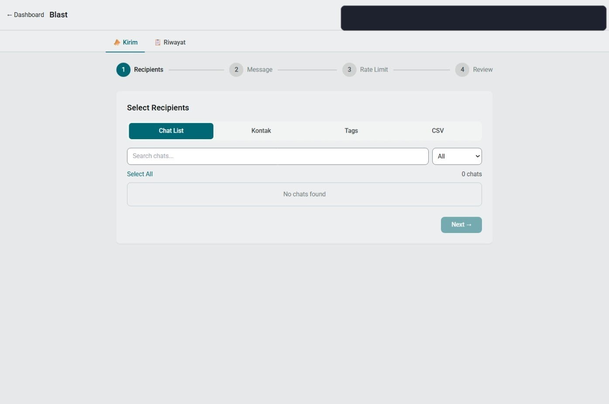

# ChatBareng — WhatsApp CS Hub

**Multi-agent WhatsApp customer service hub.** Satu (atau banyak) nomor WhatsApp, banyak CS agent, antrean rapi, otomasi yang enak. Dibangun untuk operasi CS yang serius: Node.js + Baileys + Express + Vue 3 (PWA) + Socket.IO + Prisma/SQLite.

> **Current: v4.6.13** — [CHANGELOG.md](CHANGELOG.md) (semua rilis user-verified)
> Windows? Download installer siap pakai: **[ChatBareng-Install.exe (installer)](https://github.com/kanaaka/ChatBareng-SaaS/releases/download/installer-v1.0.0/ChatBareng-Install.exe)** (~85 MB) — sekali install, server jalan 100% lokal di PC kamu + URL tunnel buat diakses dari mana aja. Lihat [PANDUAN-INSTALL-WINDOWS.txt](PANDUAN-INSTALL-WINDOWS.txt).

## 🖼️ Tampilan

<p align="center">
  
  
</p>
<p align="center">
  
</p>

## ✨ Highlights

### Core
- **WhatsApp Connection** — Baileys multi-device WebSocket, QR login via web UI, session persistence, LID↔phone resolution
- **Multi nomor WA per tenant** (slot 0–2) — kontak sama ke nomor beda = chat terpisah; mode pool / assigned / mix per slot
- **Multi-user Auth** — JWT + bcrypt, role admin / CS / relay, password management
- **Chat Management** — real-time chat list, FIFO queue (Take Next), assign/release/transfer, snooze, notes, resolve + reopen
- **Real-time** — Socket.IO: pesan, typing indicator, status, antrean, sinkron multi-tab

### Automation
- **Menu Gateway** — auto-reply triage IVR-style: intro + menu bernomor (2–8 opsi + alias keyword), frekuensi per kontak, chat tak pernah nyangkut "limbo"
- **Auto Reply** — outside-hours away text + first-of-day greeting, jadwal jam operasional per kelompok hari (WIB)
- **Scheduled Messages & Blast** — kirim terjadwal + blast massal dengan progress & template
- **CSAT** — survey kepuasan otomatis pasca-resolve

### AI Assistant (CB-AI)
- **AI Reply dari Knowledge Base** — upload dokumentasi produk/SOP (file) → balasan otomatis ter-grounded pada knowledge base per-tenant, lengkap dengan **trial & aktif/nonaktif per knowledge**
- **AI Persona & Gaya Bicara** — persona + end-text penutup + disclaimer upsell & **handoff mulus ke CS manusia** kalau AI tidak yakin
- **AI Summary** — ringkasan percakapan otomatis, CS langsung paham riwayat tanpa scroll panjang
- **Hybrid Routing** — cloud model utama + fallback model lokal: hemat & tetap jalan saat cloud down; **kompatibel Ollama API** (cloud dengan API key, atau Ollama lokal di server kamu sendiri — datanya tetap di tangan kamu)
- **AI Usage metering** — pemakaian token/latensi/estimasi biaya per tenant, rapi di admin
- Gate per-plan (Pro/Max) — Lite tetap jalan tanpa AI

### Data & Privacy
- **Contacts CRM** — kontak persistent, import/export CSV, Tag Manager
- **Enkripsi at-rest** — isi pesan **AES-256-GCM** (`MSG_ENCRYPTION_KEY`), media terenkripsi
- **Notifikasi berlapis** — web push (VAPID) *content-free* (tanpa nama/isi pesan), read receipt toggle, purge
- **Analytics** — CS performance, heatmap, CSAT, lifecycle export (CSV/JSON/**Excel bulanan per nomor WA**)

### Platform
- **Multi-tenant SaaS** — plan quota per tenant (Lite/Pro/Max), branding per tenant, superadmin console + audit log
- **Public API v1** — API key scoped (`send`, `read`, `choose_slot`, `assign_agent`) + `GET /users` & `chatState` responsenya (v1.1), untuk integrasi website/cart/agent eksternal
- **PWA** — installable, service worker push, dark mode
- **Windows Installer (.exe)** — launcher portable (Node20 embedded + cloudflared tunnel + DB); tanpa admin, tanpa install Node
- **Docker Ready** — Dockerfile + docker-compose

## 🚀 Quick Start

### Windows (paling gampang — .exe installer, [installer-v1.0.0](https://github.com/kanaaka/ChatBareng-SaaS/releases/tag/installer-v1.0.0))
1. Download & jalankan `ChatBareng-Install.exe` → wizard (tanpa admin)
2. Setelah selesai: Notepad membuka kredensial superadmin — simpan
3. Jalankan **Mulai-ChatBareng.exe** → window launcher → copy URL tunnel → buka di browser
4. Login (kredensial dari Notepad) → **Hubungkan WhatsApp** (scan QR)
5. Done — server 100% lokal di PC kamu, bisa diakses dari HP/luar via URL tunnel

*(Klik pertama: SmartScreen "More info → Run anyway" — installer belum code-signed.)*

### Linux / VPS
```bash
git clone https://github.com/kanaaka/ChatBareng-SaaS.git
cd ChatBareng-SaaS
cat .env.example   # isi: PORT, JWT_SECRET, MSG_ENCRYPTION_KEY (base64 32B!), SUPERADMIN creds
npm install        # + npx prisma generate
node scripts/prestart-migrate.js   # sinkron skema DB (db push, self-healing)
node src/server.js                 # buka http://localhost:5047
```

### Docker
```bash
docker compose up -d
```

## 🏗️ Arsitektur singkat

```
frontend/  Vue 3 PWA (Vite) ── dist → public/
src/       Express + Socket.IO + Baileys (src/wa/), routes/, services/
prisma/    SQLite schema + migrations (self-healing prestart guard)
scripts/   ops tools + MSI build (scripts/msi-build/, Linux wixl)
```

- Chat & pesan tersimpan SQLite (file:./data/) — isi pesan & media terenkripsi at-rest
- Sesi WhatsApp per slot: `data/wa-session/`
- `npm run dev` = dev mode; `npm run build:frontend` = produksi

## 🔐 Kebijakan privasi desain

Tidak ada data yang keluar: sesi WhatsApp, DB, media — semuanya file LOKAL di folder app. Auto-reply & push notification tidak membawa isi pesan. Ini software yang kamu jalankan di server KAMU.

## 📦 Versi & rilis

Semua rilis di-[CHANGELOG.md](CHANGELOG.md). Tag + installer di [Releases](https://github.com/kanaaka/ChatBareng-SaaS/releases).

## 📄 License

[MIT](LICENSE) — © 2026 Kanaka Prabhata (kanaaka)

## 🙏 Credits

Dibangun di atas: [Baileys](https://github.com/WhiskeySockets/Baileys), Express, Socket.IO, Prisma, Vue 3, Vite, plus ribuan paket OSS lain — terima kasih semua.
